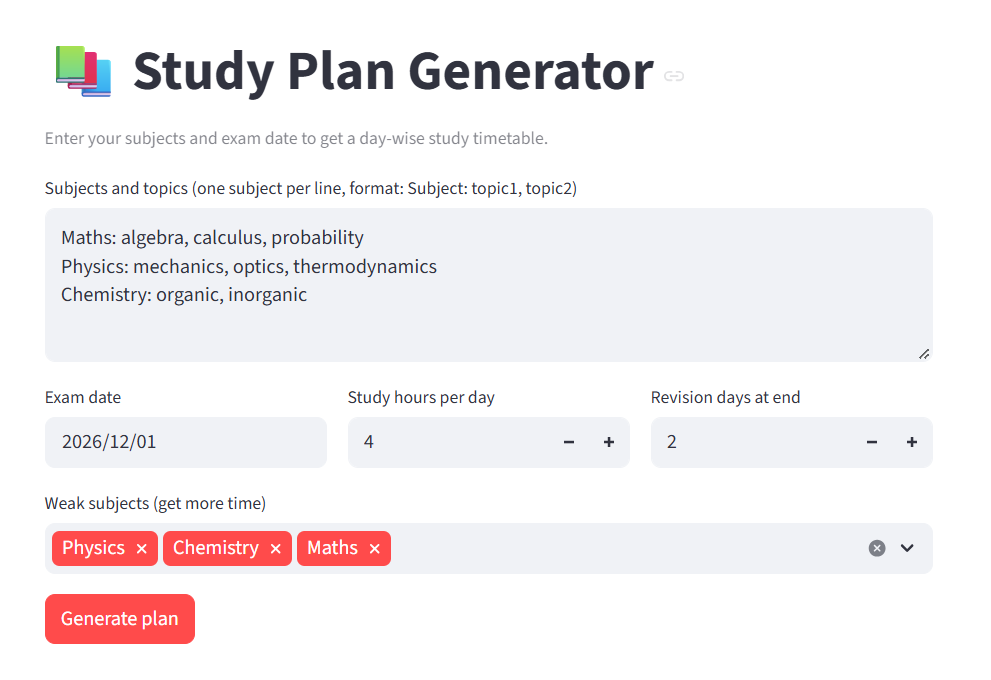
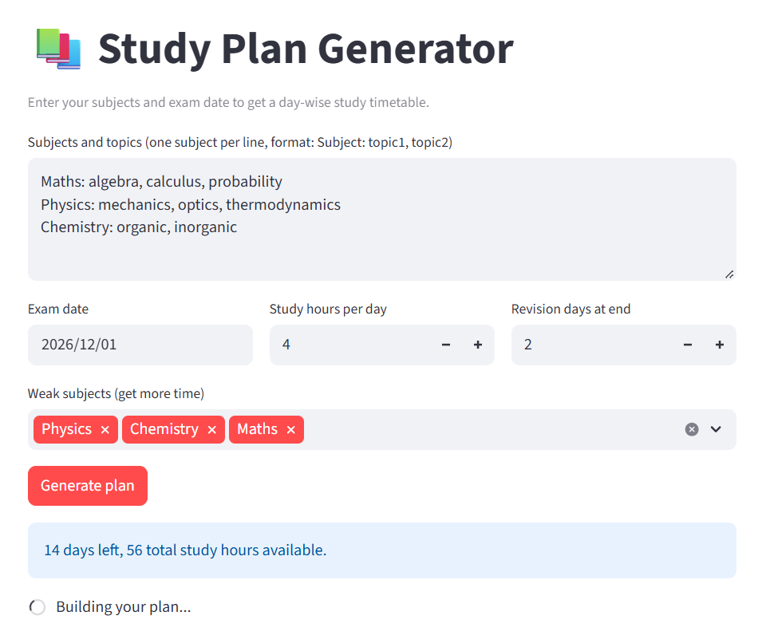
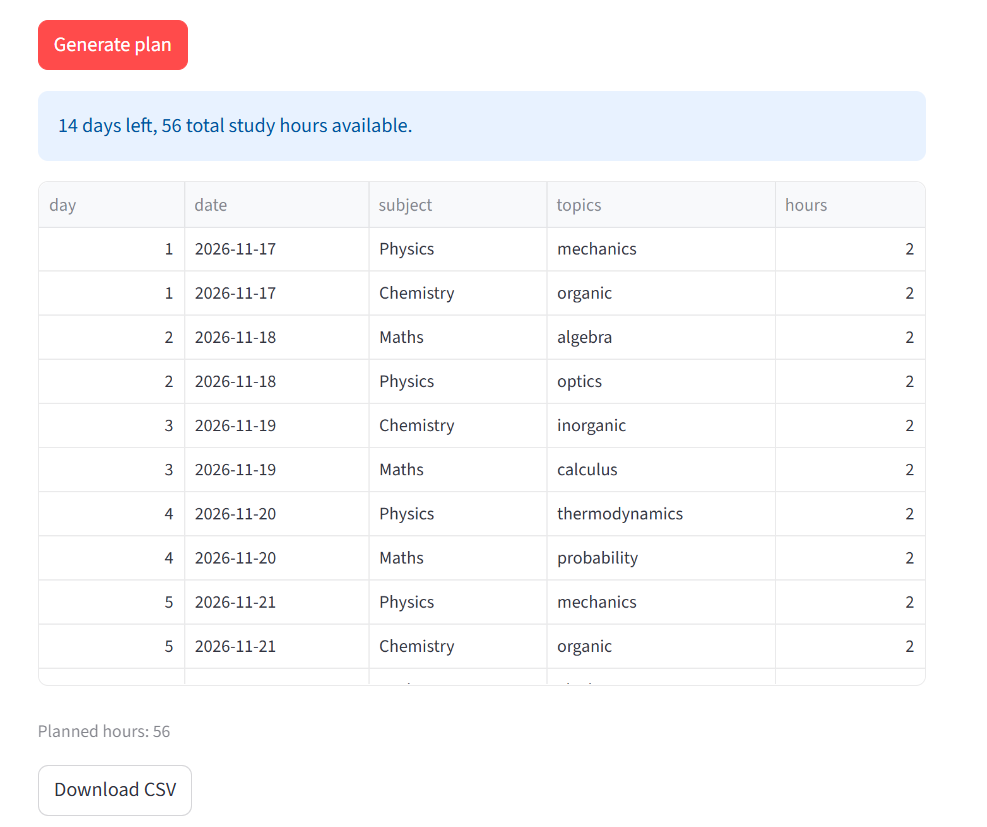
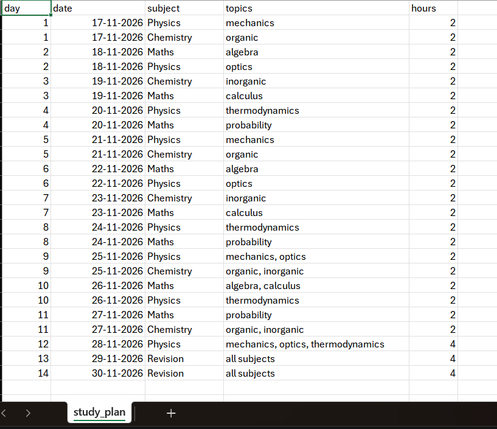

# 📚 Study Plan Generator
### LLM Mini Project 

A Streamlit web app that takes your subjects, syllabus topics, exam date, and daily study hours, then asks Google Gemini to build a complete day-wise study timetable. Date arithmetic is handled in Python so the model only does what it's good at: reasoning about scheduling.

---

## Features

- **Syllabus parser** — enter subjects and topics in a simple `Subject: topic1, topic2` format
- **Smart scheduling** — Gemini distributes topics across available days, putting harder subjects earlier and mixing subjects to avoid fatigue
- **Weak subject prioritisation** — mark subjects you struggle with; they get more slots
- **Revision buffer** — reserve the last N days purely for revision
- **Daily hour cap** — total hours on any day never exceed your specified limit
- **Instant table view** — results shown as a clean, sortable dataframe
- **CSV export** — download the full plan with one click

---

## Screenshots

### Input form


### Filled-in form with weak subjects selected


### Generated day-wise plan


### Exported CSV opened in Excel


---

## How it works

1. `parse_syllabus()` converts the text-area input into a `{subject: [topics]}` dictionary.
2. Python's `datetime` counts the exact days left — the LLM is never trusted with date arithmetic.
3. `build_prompt()` injects subjects, topics, days left, hours/day, weak subjects, and revision days into a structured prompt.
4. The Gemini API is called with `response_mime_type = "application/json"`, which forces clean JSON output.
5. The JSON list is loaded into a pandas DataFrame and displayed in Streamlit with a CSV download button.

---

## Project structure

```
Study plan Generator/
├── app.py               # Main Streamlit application
├── requirements.txt     # Python dependencies
├── .env.example         # Template for the API key
├── .env                 # Your actual API key (git-ignored)
├── Report.md            # Project report
├── Screenshots/
│   ├── 01_input_form.png
│   ├── 02_input_form_filled.png
│   ├── 03_generated_plan_table.png
│   └── 04_exported_csv.png
└── README.md
```

---

## Setup & run

### Prerequisites
- Python 3.9+
- A free Gemini API key from [Google AI Studio](https://aistudio.google.com/apikey)

### Steps

```bash
# 1. Clone the repo
git clone <your-repo-url>
cd "Study plan Generator"

# 2. Install dependencies
pip install -r requirements.txt

# 3. Add your API key
cp .env.example .env
# Open .env and replace "your_key_here" with your actual key

# 4. Run the app
streamlit run app.py
```

The app opens at `http://localhost:8501`.

> **No `.env` file?** You can also paste the API key directly into the sidebar field in the browser — no file needed.

---

## Usage

| Field | Description |
|---|---|
| **Subjects and topics** | One subject per line: `Maths: algebra, calculus` |
| **Exam date** | The date of your exam (must be in the future) |
| **Study hours per day** | How many hours you can study each day (1–16) |
| **Revision days at end** | Days reserved for full revision (0–7) |
| **Weak subjects** | Subjects selected here get extra time in the schedule |

Click **Generate plan** — your timetable appears in seconds.

---

## Tech stack

| Component | Library / Service |
|---|---|
| UI | [Streamlit](https://streamlit.io) |
| Table & CSV | [pandas](https://pandas.pydata.org) |
| LLM | Google Gemini (`gemini-3.1-flash-lite`) via [google-genai](https://pypi.org/project/google-genai/) |
| Env config | [python-dotenv](https://pypi.org/project/python-dotenv/) |
| Language | Python 3 |

---

## Known limitations

- The model may occasionally repeat a topic across days rather than spreading all topics evenly; regenerating usually fixes it.
- Very short prep windows (1–2 days) produce a crash-schedule with limited topic coverage.
- Free-tier API rate limits can cause intermittent errors; waiting a few seconds and retrying resolves them.

---

## Author

**Maitri Mahesh Movaliya** — Roll No. 25, LY CORE 6, MIT-ADT University, Pune
