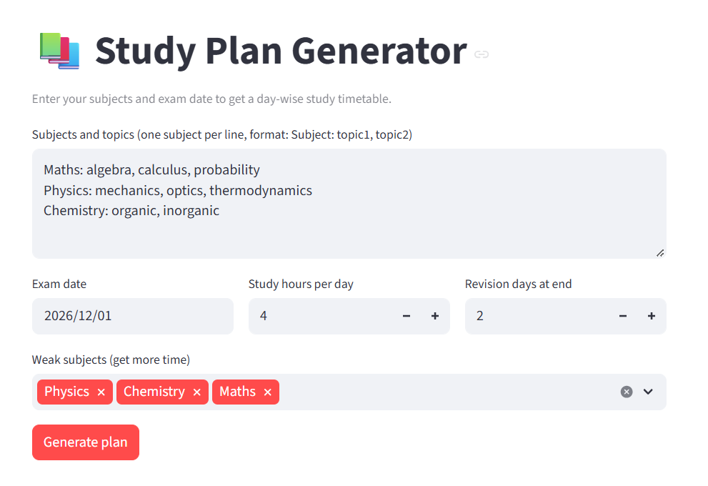
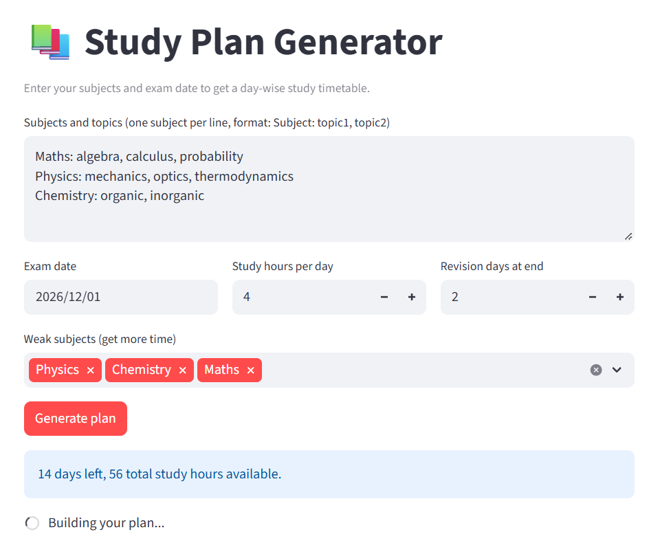
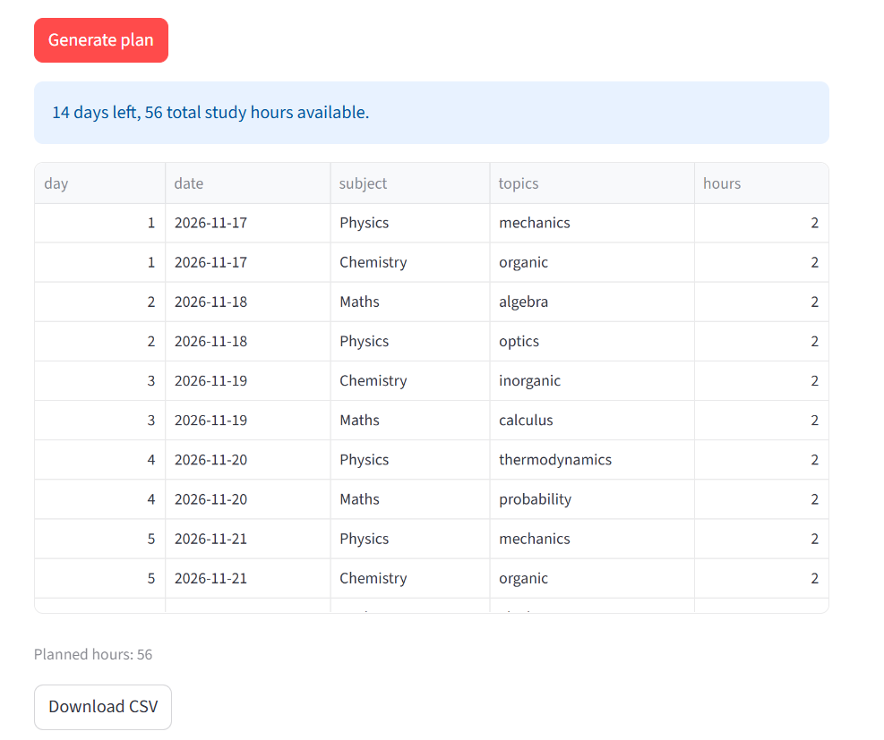
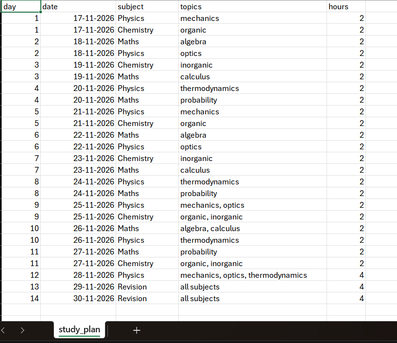

# LLM Mini Project Report: Study Plan Generator

| Field | Detail |
|---|---|
| **PS No** | 25 |
| **Name** | Maitri Mahesh Movaliya |
| **Roll No** | 25 |
| **Class** | LY CORE 6, MIT-ADT University, Pune |
| **GitHub** | _\<paste repo link\>_ |

---

## 1. Problem Statement

Students often fail to plan exam preparation effectively, leading to last-minute cramming and poor coverage of topics. This project generates a personalised, day-wise study timetable from four inputs: subjects with their syllabus topics, an exam date, and daily available study hours. It targets students who feel overwhelmed before exams and need a clear daily target.

---

## 2. Tools & Model

| Component | Detail |
|---|---|
| Language | Python 3 |
| UI framework | Streamlit |
| Data handling | pandas |
| Environment config | python-dotenv |
| LLM SDK | google-genai (v3.4.0) |
| **LLM used** | **Google Gemini `gemini-3.1-flash-lite`** via Google AI Studio free API |

> **Note on model selection:** The project was originally built targeting `gemini-2.5-flash`, but that model returned a `404 NOT_FOUND` error for new API keys. After listing available models programmatically, `gemini-3.1-flash-lite` was confirmed as the working model for this key tier and is used throughout.

---

## 3. Procedure

1. Created a virtual environment and installed `streamlit`, `pandas`, `python-dotenv`, and `google-genai`.
2. Generated a free API key from Google AI Studio and stored it in a `.env` file (excluded from Git via `.gitignore`).
3. Tested the prompt structure in AI Studio playground with three sample inputs before writing application code.
4. Wrote `parse_syllabus()` to convert `Subject: topic1, topic2` lines into a `{subject: [topics]}` dictionary.
5. Used Python's `datetime` module to compute days left and total study hours — LLMs are unreliable at date arithmetic, so this is kept in Python entirely.
6. Wrote `build_prompt()` to inject subjects, days left, hours per day, weak subjects, and revision days into a structured prompt with explicit scheduling rules.
7. Called the model using `types.GenerateContentConfig(response_mime_type="application/json")` to enforce clean JSON output, then parsed the response into a pandas DataFrame.
8. Built the Streamlit UI: syllabus text area, exam date picker, study hours and revision days inputs, weak-subject multiselect, a full-width table view, planned-hours summary, and a CSV download button.
9. Added input validation for past exam dates, empty syllabus, missing API key, and revision days exceeding available days.
10. Tested on five different inputs, captured screenshots, and confirmed CSV export works correctly.

---

## 4. Prompt Used

```
You are an expert study planner.
Today is {today}. The exam is on {exam_date} ({days_left} days from today).
The student can study {hours} hours per day.

Subjects and topics:
{syllabus}

Weak subjects (give these more time): {weak}

Rules:
1. Create exactly one entry per subject block per day, from today until the day before the exam.
2. Total hours on any single day must not exceed {hours}.
3. Cover every topic at least once.
4. Put harder/larger subjects earlier and mix subjects to avoid fatigue.
5. Reserve the last {revision_days} day(s) purely for revision (subject = "Revision").

Return ONLY a JSON list. Each item must have these keys:
"day" (int), "date" (YYYY-MM-DD), "subject" (str), "topics" (str), "hours" (number).
```

**Iteration made:** The first version returned plain prose, which was hard to parse and display. Switching to `response_mime_type = "application/json"` and adding an explicit output schema (with key names and types) produced clean, table-ready JSON consistently.

---

## 5. Results

### Sample input
- Subjects: Maths (algebra, calculus, probability), Physics (mechanics, optics, thermodynamics), Chemistry (organic, inorganic)
- Exam date: 14 days from today
- Study hours: 4 per day
- Revision days: 2
- Weak subjects: Physics, Chemistry, Maths

### Sample output
A 14-row-per-day table (each day can have multiple subject rows), with the last two days marked as **Revision**. Total planned hours matched the available 56 hours. Downloadable as `study_plan.csv`.

### Screenshots

**Input form**


**Filled form with weak subjects selected**


**Generated plan table**


**Exported CSV in Excel**


---

## 6. Challenges & Fixes

| Challenge | Fix |
|---|---|
| Model returned JSON wrapped in extra markdown text | Used `response_mime_type = "application/json"` to force raw JSON |
| LLM computed wrong days remaining | Moved all date arithmetic to Python `datetime`; only the computed number is passed in the prompt |
| `gemini-2.5-flash` returned 404 for new API keys | Listed available models programmatically; switched to `gemini-3.1-flash-lite` which works on this key tier |
| Free-tier rate limits caused intermittent errors | Wrapped the API call in a `try/except` and surfaced a clear `st.error()` message so the user knows to retry |
| Config dict `{"response_mime_type": ...}` incompatible with SDK v3 | Replaced with `types.GenerateContentConfig(response_mime_type="application/json")` |

---

## 7. Conclusion

The app reliably produces day-wise timetables that respect the daily hour cap, prioritise weak subjects, and reserve revision days. It handles bad input gracefully and exports clean CSV files.

**Limitations:** Topic coverage is not verified programmatically — the model decides distribution, and may repeat some topics. Very short windows (1–2 days) produce limited plans.

**Future improvement:** Add a progress tracker so the user can mark topics as done, and have the app re-generate a rebalanced plan for the remaining days.
